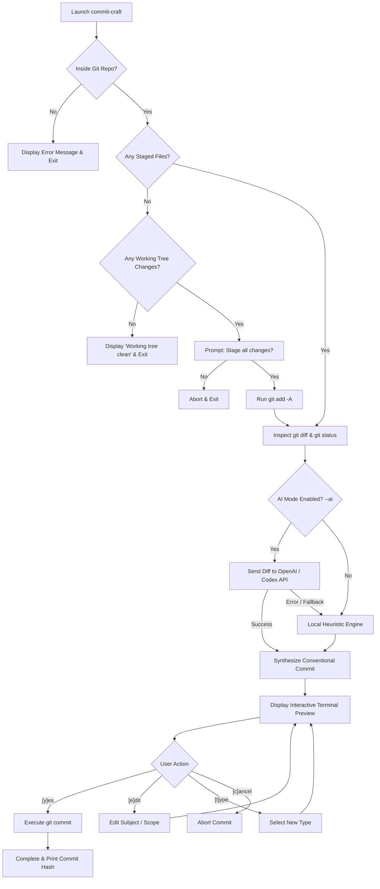

# commit-craft 🛠️✨

[](https://github.com/Aderali06/commit-craft/actions/workflows/ci.yml)
[](https://www.python.org/)
[](LICENSE)
[](https://conventionalcommits.org)
[](https://openai.com)

**commit-craft** is an open-source, developer-first command-line tool (CLI) that intelligently inspects Git repository changes (`git diff` and `git status`), synthesizes meaningful commit messages adhering to the **[Conventional Commits v1.0.0](https://www.conventionalcommits.org/)** specification, integrates seamlessly with the **OpenAI AI / Codex Engine**, renders an interactive terminal preview, and executes `git commit` upon user confirmation.

---

## 🌟 Key Features

- 🧠 **Hybrid Commit Generation Engine**:
  - 🏠 **Local Heuristic Engine**: 100% offline, lightning-fast, zero external API dependencies, analyzing changed files and diff syntax intelligently.
  - 🤖 **OpenAI AI / Codex Engine (`--ai`)**: Leverages language models (e.g., `gpt-4o-mini`, `gpt-4o`, `o3-mini`) for deep semantic diff comprehension.
- 🔍 **Comprehensive Git Analysis**: Reads staged changes (`git diff --cached`) as well as modified and untracked files (`git status`).
- 🏷️ **Automatic Conventional Commit Type Classification**:
  - `feat`: New features, functions, classes, or endpoints.
  - `fix`: Bug fixes, error handlers, and patch resolutions.
  - `docs`: Documentation updates (`README.md`, docs files, licenses).
  - `test`: Adding or updating test suites and specs.
  - `ci`: CI/CD automation pipelines (GitHub Actions, GitLab CI, etc.).
  - `build`: Dependency management and build configs (`pyproject.toml`, `requirements.txt`).
  - `style`: Code formatting, linters, or style configurations.
  - `refactor`: Code restructuring, file removals, or renames.
  - `perf`: Performance optimizations and compute improvements.
  - `chore`: General repository maintenance.
- 🎯 **Precise Scope Detection**: Automatically infers module/package scopes from file paths.
- 🖥️ **Interactive Terminal Preview**: Displays a clean visual card with colored status indicators (`[A]` Added, `[M]` Modified, `[D]` Deleted, `[R]` Renamed).
- ✍️ **Flexible Confirmation Workflow**:
  - `[y]es`: Accept proposal and execute `git commit` immediately.
  - `[e]dit`: Edit the subject or scope directly in the terminal prompt.
  - `[t]ype change`: Switch to a different commit type interactively.
  - `[c]ancel`: Abort the commit cleanly.
- ⚡ **Full CLI Options**: Includes `--all` (`-a`), `--ai` (`-A`), `--model`, `--type` (`-t`), `--scope` (`-s`), `--message` (`-m`), `--dry-run`, and `--no-body`.

---

## 🔄 Workflow



---

## 📦 Installation

### 1. Clone the Repository

```bash
git clone https://github.com/Aderali06/commit-craft.git
cd commit-craft
```

### 2. Set Up Environment & Install Dependencies

Using a virtual environment is recommended:

```bash
# Create virtual environment
python -m venv .venv

# Activate virtual environment
# On Windows:
.venv\Scripts\activate
# On Linux/macOS:
source .venv/bin/activate

# Install dependencies
pip install -r requirements.txt
```

### 3. Install CLI Locally (Editable Mode)

```bash
pip install -e .
```

Once installed, the `commit-craft` command is globally available in your active terminal environment.

---

## 🚀 Usage Guide

### 1. Standard Usage (Local Heuristic Engine)

Stage your changes with `git add`, then run:

```bash
commit-craft
```

### 2. Using OpenAI AI / Codex Engine (`--ai`)

To leverage OpenAI language models for crafting context-aware commit messages:

```bash
# Set your OpenAI API Key
export OPENAI_API_KEY="sk-..."    # Linux/macOS
set OPENAI_API_KEY="sk-..."       # Windows CMD
$env:OPENAI_API_KEY="sk-..."      # Windows PowerShell

# Run with AI mode
commit-craft --ai

# Or specify a custom model
commit-craft --ai --model gpt-4o
```

> **Note**: If the API key is not configured or network connectivity is unavailable, `commit-craft` automatically falls back to the built-in heuristic engine without disrupting your workflow.

### 3. Automatically Stage All Changes (`-a` / `--all`)

To stage all modified and untracked files before committing:

```bash
commit-craft -a
```

### 4. Dry-Run Mode (Preview Without Committing)

```bash
commit-craft --dry-run
commit-craft --ai --dry-run
```

### 5. Explicitly Specify Type, Scope, or Subject

```bash
commit-craft -t feat -s auth
commit-craft -t fix -m "resolve null pointer exception on diff parser"
```

### 6. Single-line Commit Without Body (`--no-body`)

```bash
commit-craft --no-body
```

---

## 🖥️ Terminal Preview Example

```text
  ____                            _ _          ____            __ _   
 / ___|___  _ __ ___  _ __ ___  (_) |_       / ___|_ __ __ _ / _| |_ 
| |   / _ \| '_ ` _ \| '_ ` _ \ | | __|____ | |   | '__/ _` | |_| __|
| |__| (_) | | | | | | | | | | || | ||_____|| |___| | | (_| |  _| |_ 
 \____\___/|_| |_| |_|_| |_| |_|/ |\__|      \____|_|  \__,_|_|  \__|
                              |__/                                    
  Commit Craft v0.1.0 — Automated Conventional Commits

┌─ [ Proposed Conventional Commit ] ────────────────────────────────────────
│  Type    : feat
│  Scope   : cli
│  Subject : implement automatic Conventional Commit generator
├────────────────────────────────────────────────────────────────────────────
│  Full Message Preview:
│    feat(cli): implement automatic Conventional Commit generator
│    
│    - Added: commit_craft/main.py
│    - Added: tests/test_main.py
├────────────────────────────────────────────────────────────────────────────
│  Files Included (2):
│    [A] commit_craft/main.py
│    [A] tests/test_main.py
└────────────────────────────────────────────────────────────────────────────

Action ([y]es / [e]dit / [t]ype change / [c]ancel): y
ℹ Executing git commit...
✔ Git commit executed successfully!
[main a1b2c3d] feat(cli): implement automatic Conventional Commit generator
 2 files changed, 450 insertions(+)
 create mode 100644 commit_craft/main.py
 create mode 100644 tests/test_main.py
```

---

## ⚙️ Command-Line Options (CLI Flags)

| Argument | Short | Description |
| :--- | :--- | :--- |
| `--all` | `-a` | Stage all modified & untracked files (`git add -A`) |
| `--ai` | `-A` | Use OpenAI API / Codex to synthesize commit messages intelligently |
| `--model` | | Specify OpenAI model name (default: `gpt-4o-mini`) |
| `--api-key` | | Pass OpenAI API key explicitly |
| `--type` | `-t` | Enforce commit type (`feat`, `fix`, `docs`, `refactor`, `test`, `ci`, `build`, etc.) |
| `--scope` | `-s` | Manually specify commit scope (e.g., `api`, `auth`, `core`) |
| `--message` | `-m` | Provide commit subject directly |
| `--no-body` | | Generate single-line commit title without file summary body |
| `--dry-run` | | Preview commit proposal without executing `git commit` |
| `--version` | `-v` | Show application version |
| `--help` | `-h` | Display help menu and list of available options |

---

## 🧪 Running Tests

The project comes with 51 unit tests using `pytest`:

```bash
# Run all unit tests
pytest -v

# Run tests with test coverage reporting
pytest --cov=commit_craft
```

---

## 📁 Repository Structure

```text
commit-craft/
├── .github/
│   ├── ISSUE_TEMPLATE/
│   │   ├── bug_report.md      # Bug report issue template
│   │   └── feature_request.md # Feature request issue template
│   ├── workflows/
│   │   └── ci.yml             # GitHub Actions multi-OS CI workflow
│   └── pull_request_template.md # Pull request review template
├── commit_craft/
│   ├── __init__.py            # Package metadata & exports
│   ├── ai_generator.py        # OpenAI API / Codex model integration
│   └── main.py                # Core CLI logic, git execution, & Conventional Commits
├── tests/
│   ├── test_ai_generator.py   # Unit tests for AI engine & HTTP mocking
│   └── test_main.py           # Unit tests for Git operations & commit heuristics
├── CODE_OF_CONDUCT.md         # Community code of conduct (Contributor Covenant v2.1)
├── CONTRIBUTING.md             # Developer contribution guidelines
├── .gitignore                 # Python & OS artifact ignores
├── LICENSE                    # Official MIT License
├── pyproject.toml             # PEP 621 packaging & pytest configuration
├── requirements.txt           # Dependency requirements
├── SECURITY.md                # Security vulnerability reporting policy
└── README.md                  # Comprehensive project documentation
```

---

## 📄 License & Community

This project is licensed under the **MIT License**. See the [LICENSE](LICENSE) file for details.
To contribute, please read [CONTRIBUTING.md](CONTRIBUTING.md) and adhere to the [CODE_OF_CONDUCT.md](CODE_OF_CONDUCT.md).
